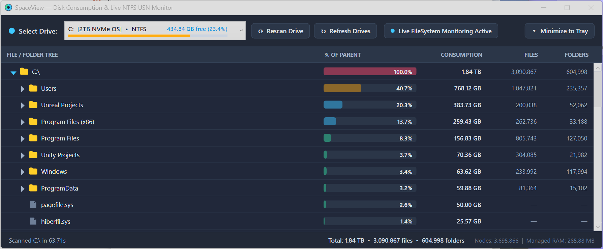
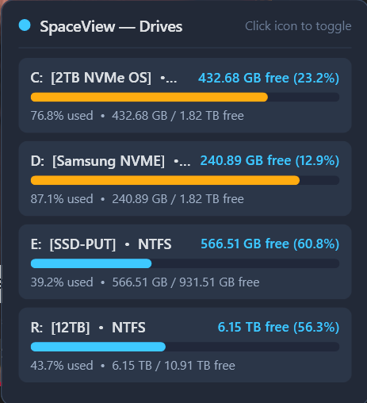

# SpaceView

**SpaceView** is a high-performance, memory-efficient Windows disk space analyzer and live NTFS consumption monitor built with C# and .NET 8 (WPF + Native Win32 Interop).

When launched, SpaceView presents a drive selector drop-down displaying all ready volumes and their capacity bars. Once a drive is selected, SpaceView scans the volume using multi-threaded native directory index queries, displays the hierarchy in a virtualized TreeListView with a **% of Parent** visual consumption bar column, and continuously monitors **NTFS** volumes for real-time file and folder changes via the **NTFS USN Change Journal**.

---

## Screenshots

### Main Window — File/Folder Consumption Tree & Live Monitoring
*Scanning **1.84 TB** across **3,090,867 files** and **604,998 folders** (**3,695,866 total nodes**) in **285.88 MB** of managed RAM:*



### System Tray Hover Popup — Live Drive Free Space & Capacity Bars
*Hovering over the system tray icon displays all ready drives with free space, percentages, and color-coded capacity bars:*



---

## Key Features

- **Drive Selection Drop-Down on Launch**: Immediately lists all ready local drives with volume labels, file system format (`NTFS`, `exFAT`, `ReFS`, etc.), free space/percentage, and inline graphical usage bars.
- **High-Speed Multi-Threaded Native Scanning**:
  - Uses native Win32 `GetFileInformationByHandleEx` (`FileIdBothDirectoryInfo`) with 64 KB aligned native buffers across worker threads to read NTFS `$I30` directory index blocks in bulk.
  - Captures both 64-bit NTFS File Reference Numbers (`FileId`) and `EndOfFile` sizes in a single pass while skipping directory reparse points/junctions to prevent cycles or double-counting.
- **Ultra-Low Memory Footprint for Millions of Files**:
  - **Compact Struct Arena (`FileSystemStore`)**: Stores all file and directory records in fixed 64K-node struct chunks (`NodeRecord`) using intrusive singly-linked lists (`FirstChildId` / `NextSiblingId`) and 1 MB UTF-8 name slabs instead of heap-allocated object graphs or full path strings.
  - **UI Virtualization**: Only materializes `TreeRowViewModel` instances for expanded rows currently in view, using `VirtualizingStackPanel` in recycling mode.
- **Real-Time NTFS USN Change Journal Monitoring**:
  - Queries the NTFS USN Journal (`FSCTL_QUERY_USN_JOURNAL`) prior to scanning and continuously tails `FSCTL_READ_USN_JOURNAL` (`USN_RECORD_V2`) records in the background (with automatic fallback to `FileSystemWatcher` when running unprivileged or on non-NTFS volumes).
  - Propagates file creations, deletions, renames, and size changes up the parent directory chain in $O(\text{depth})$ time and updates the visible tree and percentages live.
- **System Tray Application & Custom Hover Popup**:
  - Minimizes cleanly to the Windows System Tray.
  - **Hover Popup**: Hovering over the tray icon displays a sleek non-activating popup card showing all current drives, free space, free/used percentages, and color-coded graphical bars.
  - **One-Click Toggle**: Left-clicking the tray icon shows or hides the main window.
- **Context Menu Actions**:
  - Right-click any file or folder row to **Open in Explorer**, **Copy Full Path**, open the native Windows **Properties** dialog, or **Delete to Recycle Bin**.

---

## Project Structure

```text
SpaceView/
├── SpaceView.sln                        # Visual Studio 2022 Solution
├── install.ps1 / install.bat            # Installer script (publishes to LocalAppData & creates Start Menu icon)
├── uninstall.ps1 / uninstall.bat        # Uninstaller script
├── Screenshot.png                       # Main application screenshot
├── Screenshot_Tray.png                  # System tray hover popup screenshot
└── SpaceView/
    ├── SpaceView.csproj                 # .NET 8 WPF / WinForms interop project
    ├── app.manifest                     # Long-path & Windows 10/11 compatibility manifest
    ├── Assets/
    │   └── SpaceView.ico                # Multi-resolution application & system tray icon
    ├── App.xaml / App.xaml.cs           # Application entry & theme resources
    ├── MainWindow.xaml / .cs            # Main virtualized TreeListView UI & controller
    ├── TrayHoverWindow.xaml / .cs       # System tray hover popup window
    ├── TrayIconManager.cs               # System tray icon, hover tracking & context menu
    ├── Core/
    │   ├── FileSystemStore.cs           # Arena-backed struct store & O(depth) USN delta engine
    │   ├── VolumeScanner.cs             # Multi-threaded native volume scanner
    │   ├── NtfsUsnJournalMonitor.cs     # Real-time NTFS USN Change Journal monitor
    │   └── SizeFormatter.cs             # Human-readable byte formatting utility
    ├── Models/
    │   ├── DriveItemViewModel.cs        # Drive metadata & capacity bar model
    │   └── TreeRowViewModel.cs          # Virtualized tree row model with % of Parent bar
    └── Native/
        └── NtfsNative.cs                # Win32 / NT P/Invoke definitions (MFT, USN, Shell)
```

---

## Installation & Building

### Prerequisites
- Windows 10 or Windows 11
- [.NET 8.0 SDK](https://dotnet.microsoft.com/download/dotnet/8.0) or Visual Studio 2022

### Quick Install (Local Program Folder + Start Menu Shortcut)
Double-click `install.bat` or run `install.ps1` from PowerShell:
```powershell
.\install.ps1
```
This publishes the Release binaries to `%LOCALAPPDATA%\Programs\SpaceView`, registers the **SpaceView** shortcut (with the embedded `SpaceView.ico` icon) in your Windows Start Menu (`%APPDATA%\Microsoft\Windows\Start Menu\Programs\SpaceView.lnk`), and launches the installed app.

- To also create a Desktop shortcut: `.\install.ps1 -CreateDesktopShortcut`
- To install to a custom folder: `.\install.ps1 -InstallDir "C:\Tools\SpaceView"`
- To uninstall: double-click `uninstall.bat` or run `.\uninstall.ps1`

### Build & Run Manually via CLI
```powershell
dotnet build SpaceView.sln -c Release
.\SpaceView\bin\Release\net8.0-windows\SpaceView.exe
```

> **Tip**: Run SpaceView as Administrator if you want direct volume-level `FSCTL_READ_USN_JOURNAL` access and `SeBackupPrivilege` for scanning restricted system directories (`System Volume Information`, etc.). When run as a standard user, SpaceView automatically falls back to standard permissions and live `FileSystemWatcher` updates.
